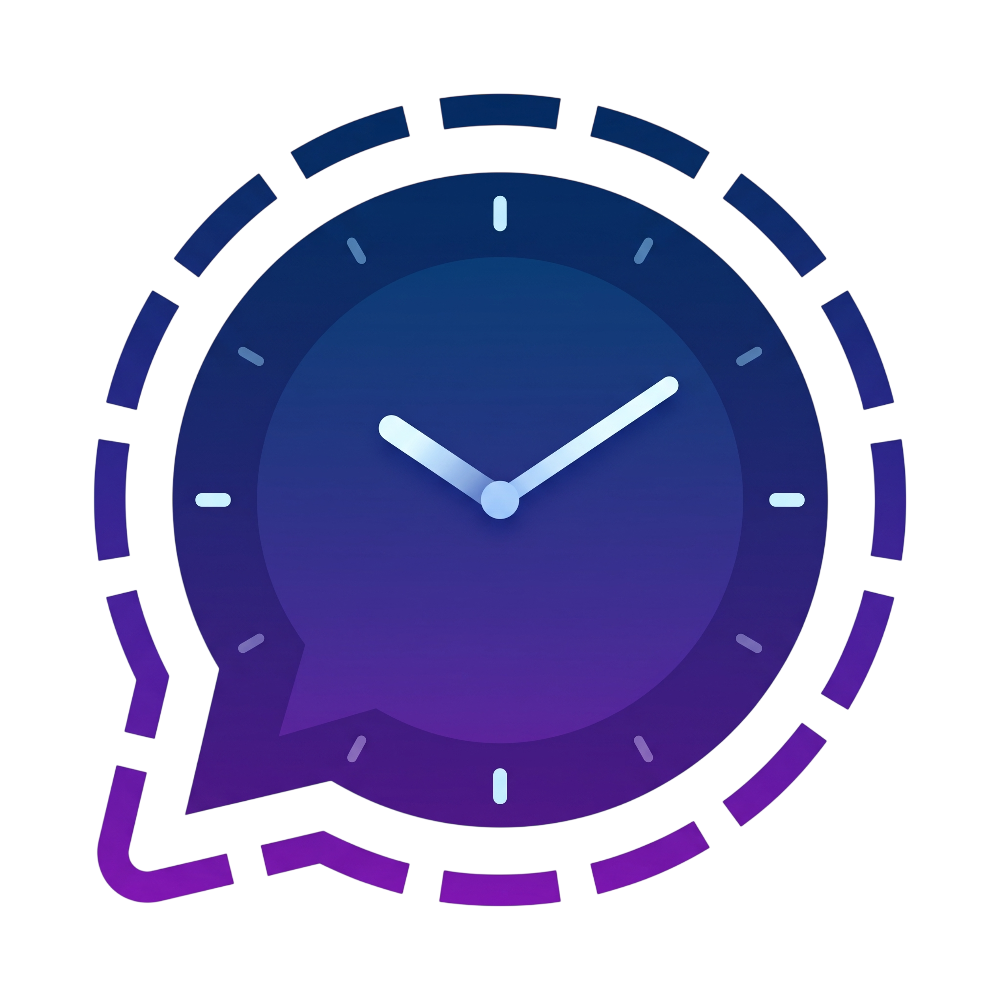

<p align="center">
  
</p>

# WearOSignal

Cliente independiente y open source de **Signal para Wear OS**, diseñado y optimizado para relojes inteligentes desde **Samsung Galaxy Watch 4 en adelante** (Wear OS 3+ / API 30+, arquitecturas `armeabi-v7a` y `arm64-v8a`).

**Developed by Cristian Camilo** ([@criscamilotv en X](https://x.com/criscamilotv)) · [Página oficial / Documentación](https://soycamiloypunto.github.io/wearosignal/) · [Política de Privacidad](https://soycamiloypunto.github.io/wearosignal/#privacy)

> **Aviso legal**: WearOSignal es un cliente independiente y no oficial para Signal, no afiliado ni respaldado por Signal Messenger, LLC. Distribuido bajo licencia **GNU AGPLv3** ([LICENSE](LICENSE)).

---

## Características principales

### Interfaz diseñada para pantallas circulares (Wear OS)
- **Menú principal en círculos**: cuadrícula de 3 avatares circulares por fila con fotos descifradas de contactos/grupos y accesos rápidos circulares (**Sincronizar**, **Nuevo chat** y **Ajustes**).
- **Barra de respuesta de 3 botones** dentro de cada conversación:
  - **🎤 Notas de voz**: grabación directa desde el micrófono del reloj (`AAC / M4A`, 44.1 kHz, 64 kbps mono) con **ondas dinámicas en tiempo real** (`MediaRecorder.maxAmplitude`), subida cifrada a Signal CDN V4 y *sync transcript* hacia tu teléfono.
  - **😊 9 emojis favoritos personalizables**: toca cualquier emoji para enviarlo al instante, o pulsa **`＋`** para editar y guardar permanentemente tus 9 emojis más usados.
  - **Aa Texto / Dictado**: teclado nativo y dictado por voz de Wear OS (`RemoteInput`).
- **5 respuestas rápidas personalizables**: ubicadas justo debajo de la barra de respuesta al deslizar hacia abajo, con modo de edición integrado y persistencia local.
- **Reacciones a mensajes**: mantén presionada cualquier burbuja para reaccionar con emojis (o retirar tu reacción).
- **Tile y Complication**: acceso rápido a chats recientes y contador de mensajes sin leer en la carátula del reloj.
- **Idiomas**: localización nativa en **español** e **inglés** (`strings.xml`).

### Compatibilidad multimedia
- **Fotos (`JPG`, `PNG`)**: descarga cifrada, redimensionamiento a resolución de reloj y retención automática (7 días / tope de 64 MB).
- **Stickers y GIFs animados (`WebP`, `GIF`)**: soporte nativo mediante `ImageDecoder` + `AnimatedImageDrawable` (Android 11+) preservando transparencia y animaciones.
- **Audios y notas de voz (`AAC`, `M4A`, `OGG`, `MP3`)**: reproducción directa en la burbuja del chat (`MediaPlayer`).
- **Videos (`MP4`)**: reproductor integrado en pantalla completa (`VideoView`).

---

## Arquitectura técnica y seguridad

| Componente | Implementación |
| :--- | :--- |
| **Protocolo** | Vinculación como dispositivo secundario (QR de aprovisionamiento) sobre `libsignal-android` (`0.94.4`) y `lib:libsignal-service`. |
| **Servidores** | Conexión directa y exclusiva a endpoints oficiales de Signal (`chat.signal.org`, `storage.signal.org`, `cdn/cdn2/cdn3.signal.org`, `cdsi.signal.org`, `svr2.signal.org`) validados con `whisper.store`. **Cero servidores intermedios, telemetría o rastreadores.** |
| **Subida de adjuntos V4** | Solicitud `GET /v4/attachments/form/upload?uploadLength=<ciphertextLength>` (cálculo con `PaddingInputStream` + `AttachmentCipherStreamUtil`) y subida cifrada vía `ResumableUploadSpec`. |
| **Cifrado en reposo** | Credenciales y claves de identidad (`password`, `aci_identity`, `pni_identity`, `profile_key`) cifradas en `SharedPreferences` con **Android Keystore (`AES/GCM/NoPadding`, 256-bit)** en `KeystoreSecretBox.kt`. |
| **Desvinculación local** | Botón **Desvincular reloj** en Ajustes con doble confirmación que detiene tareas, desconecta el socket y borra claves, SQLite, avatares y adjuntos. |
| **Cumplimiento Google Play** | Sin `USE_EXACT_ALARM` ni `SCHEDULE_EXACT_ALARM` (usa `setAndAllowWhileIdle` + `WorkManager`), soporte 32-bit y 64-bit (`armeabi-v7a`, `arm64-v8a`), R8/ProGuard (`proguard-rules.pro`) y opciones de depuración ocultas en `release`. |

### Permisos utilizados
- `INTERNET`: comunicación cifrada de extremo a extremo con los servidores oficiales de Signal.
- `POST_NOTIFICATIONS` / `VIBRATE` / `WAKE_LOCK` / `RECEIVE_BOOT_COMPLETED`: notificaciones de mensajes entrantes y mantenimiento en segundo plano.
- `READ_CONTACTS`: descubrimiento opcional de contactos locales registrados en Signal mediante CDSI (SGX).
- `RECORD_AUDIO`: grabación de notas de voz (solicitado únicamente cuando el usuario pulsa el botón de micrófono).

---

## Compilación desde código fuente

Requisitos: **JDK 17+** (probado con OpenJDK 21), **Android SDK Platform 36**, **NDK `27.2.12479018`** y `platform-tools` (`adb`).

```powershell
# 1. Compilar desde el código fuente
.\gradlew.bat :app:assembleDebug

# 2. Instalar en reloj Wear OS en modo desarrollador (ADB inalámbrico)
adb pair <IP>:<PUERTO_EMPAREJAMIENTO>
adb connect <IP>:<PUERTO>
adb install -r --no-streaming app\build\outputs\apk\debug\app-debug.apk
```

> La versión precompilada y con actualizaciones automáticas se distribuirá oficialmente a través de **Google Play Store**.

---

## Licencia y cumplimiento (GNU AGPLv3)

Este proyecto se distribuye bajo la **GNU Affero General Public License v3.0 (AGPLv3)** — consulta el texto completo en [LICENSE](LICENSE).

- Puedes usar, estudiar, modificar y redistribuir el software bajo los términos de la AGPLv3.
- El código fuente completo de todas las versiones publicadas (incluyendo las distribuidas en Google Play Store) se mantiene disponible públicamente en este repositorio.
- Utiliza componentes de código abierto de Signal (`libsignal` / `libsignal-service`), también licenciados bajo AGPLv3.
